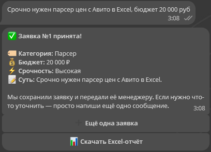
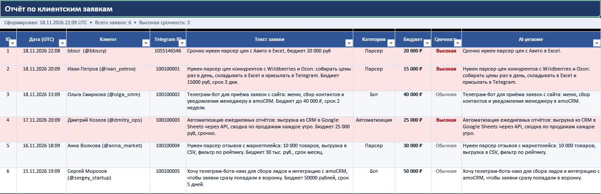
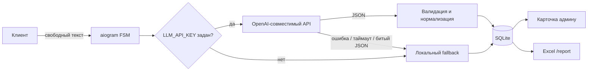

# 🤖 AI Lead Excel Bot

**Telegram-бот, который превращает свободный текст клиента в структурированную заявку и готовый Excel-отчёт.**

Клиент пишет «Нужен парсер цен конкурентов с маркетплейса в Excel, бюджет 15000 руб, срок 3 дня» — бот сам определяет категорию, бюджет и срочность, сохраняет заявку в SQLite, присылает красивую карточку админу и умеет выгрузить всё в стилизованный `.xlsx`.


<p align="center">
  
</p>
<p align="center">
  
</p>

> Реальные скриншоты: диалог с ботом и сгенерированный Excel-отчёт.

---

## 💼 Зачем это бизнесу

- **Клиент пишет как удобно, бизнес получает структуру.** Не нужно заставлять человека заполнять длинную форму: бот принимает заявку в свободной форме.
- **Ни одна заявка не теряется в переписке.** Каждое обращение сохраняется в SQLite вместе с датой, username и результатами анализа.
- **Админ узнаёт о заявке мгновенно.** В Telegram приходит карточка с клиентом, категорией, бюджетом, срочностью и AI-резюме.
- **Excel без ручной работы.** Команда `/report` отдаёт готовый файл с фильтрами, подсветкой срочных заявок и сводкой по категориям.
- **Работает из коробки.** Без платного API-ключа включается локальный fallback-парсер — проект можно запустить и проверить за пару минут.

Это пет-проект для портфолио, но он собран по продакшн-принципам: валидация конфига, DI через middleware, обработка ошибок внешнего API, транзакции, тесты и линтер.

---

## ✨ Возможности

| Возможность | Детали |
|---|---|
| Приём заявок | Свободный текст или FSM-сценарий по кнопке «Оставить заявку» |
| AI-анализ | Категория, бюджет, срочность и резюме в одном предложении |
| OpenAI-совместимый API | OpenAI, OpenRouter, DeepSeek, Ollama, LM Studio и другие |
| Локальный fallback | Умные эвристики по ключевым словам, суммам и дедлайнам |
| Хранение | SQLite + `aiosqlite`, WAL, запись пачкой в одной транзакции |
| Уведомление админа | HTML-карточка с экранированием пользовательских данных |
| Excel-отчёт | Два листа, жирные заголовки, автоширина, перенос текста, фильтры, подсветка |
| Демо-режим | `/demo` добавляет 5 реалистичных заявок — сразу можно проверить `/report` |
| Надёжность | Ошибка LLM или сети не ломает приём заявки — срабатывает fallback |
| Качество | 49 тестов на `pytest`, `ruff` без замечаний, CI для GitHub Actions |

---

## 🧱 Стек

| Технология | Роль |
|---|---|
| **Python 3.11+** | Асинхронный backend бота |
| **aiogram 3.x** | Telegram Bot API, роутеры, FSM, middleware |
| **aiosqlite** | Неблокирующая работа с SQLite |
| **openpyxl** | Генерация стилизованного `.xlsx` |
| **httpx** | Запросы к OpenAI-совместимому API |
| **aiohttp-socks** | HTTP/SOCKS-прокси для Telegram API |
| **python-dotenv** | Конфигурация через `.env` |
| **pytest + pytest-asyncio** | Юнит- и интеграционные тесты |
| **ruff** | Линтинг и форматирование |

---

## 🚀 Быстрый старт за 3 шага

### 1. Установка

```bash
git clone https://github.com/your-username/ai-lead-excel-bot.git
cd ai-lead-excel-bot
python -m venv .venv
```

Активируйте окружение:

```powershell
# Windows PowerShell
.venv\Scripts\Activate.ps1
```

```bash
# macOS / Linux
source .venv/bin/activate
```

Установите зависимости:

```bash
pip install -r requirements.txt
```

### 2. Настройка

Создайте `.env` из шаблона:

```powershell
# Windows
Copy-Item .env.example .env
```

```bash
# macOS / Linux
cp .env.example .env
```

Откройте `.env` и заполните минимум два поля:

```dotenv
BOT_TOKEN=123456789:AAH-your-token-from-botfather
ADMIN_ID=123456789
```

- `BOT_TOKEN` — токен из [@BotFather](https://t.me/BotFather).
- `ADMIN_ID` — ваш Telegram ID (узнать можно у [@userinfobot](https://t.me/userinfobot)).
- `LLM_API_KEY` можно оставить пустым — тогда включится локальный анализатор.
- Если `api.telegram.org` недоступен напрямую, заполните `PROXY_URL` — см. [«Прокси и IPv4»](#-прокси-и-ipv4-windows).

### 3. Запуск

```bash
python run.py
```

В консоли появится:

```text
Бот запущен | БД: .../leads.db | LLM: локальный fallback | Прокси: не используется
```

Откройте бота в Telegram и отправьте `/start`.

### Проверка за 30 секунд

1. Нажмите `/start` → «Оставить заявку» → опишите задачу.
2. Нажмите `/demo` — в базу добавятся 5 реалистичных заявок.
3. Нажмите `/report` — бот пришлёт готовый Excel-файл.
4. Откройте файл: лист «Заявки» с фильтрами и лист «Сводка» с аналитикой.

---

## ⚙️ Переменные окружения

| Переменная | Обязательна | По умолчанию | Описание |
|---|---|---|---|
| `BOT_TOKEN` | ✅ | — | Токен Telegram-бота от @BotFather |
| `ADMIN_ID` | — | пусто | Telegram ID для уведомлений; пусто — уведомления отключены |
| `LLM_API_KEY` | — | пусто | Ключ OpenAI-совместимого API; пусто — локальный fallback |
| `LLM_BASE_URL` | — | `https://api.openai.com/v1` | Базовый URL API **без** `/chat/completions` |
| `LLM_MODEL` | — | `gpt-4o-mini` | Имя модели |
| `PROXY_URL` | — | пусто | Прокси для Telegram API: `http://`, `socks4://`, `socks5://` |
| `DB_PATH` | — | `leads.db` | Путь к SQLite-файлу |
| `LLM_TIMEOUT` | — | `25` | Таймаут запроса к LLM, секунды |

### Примеры провайдеров

| Провайдер | `LLM_BASE_URL` | `LLM_MODEL` |
|---|---|---|
| OpenAI | `https://api.openai.com/v1` | `gpt-4o-mini` |
| OpenRouter | `https://openrouter.ai/api/v1` | `openai/gpt-4o-mini` |
| DeepSeek | `https://api.deepseek.com/v1` | `deepseek-chat` |
| Ollama (локально) | `http://localhost:11434/v1` | `llama3.1` |
| LM Studio (локально) | `http://localhost:1234/v1` | модель из UI LM Studio |

Для локальных провайдеров, которым не нужен ключ, укажите любой непустой
`LLM_API_KEY` (например, `ollama`) — именно непустой ключ включает LLM-режим.

---

## 🔌 Прокси и IPv4 (Windows)

Если при запуске появляется ошибка:

```text
ClientConnectorError: Cannot connect to host api.telegram.org:443 (Timeout ...)
```

значит, у бота нет прямого доступа к Telegram API. Это частая ситуация в
корпоративных сетях, при блокировках и на Windows с «залипающим» IPv6.

**1. Укажите прокси в `.env`** (только для Telegram API, LLM-запросы идут напрямую):

```dotenv
# HTTP-прокси (например, Xray / v2ray / Clash)
PROXY_URL=http://127.0.0.1:10808

# или SOCKS5
PROXY_URL=socks5://127.0.0.1:1080

# или SOCKS4
PROXY_URL=socks4://127.0.0.1:1080
```

- `socks5h://` автоматически приводится к `socks5://` (DNS-резолвинг и так выполняется на стороне прокси).
- Адрес без схемы (`127.0.0.1:10808`) трактуется как `http://`.
- Схема `https://` не поддерживается — используйте `http://`.
- Для SOCKS нужен пакет `aiohttp-socks`, он уже есть в `requirements.txt`.

**2. IPv4-only из коробки.** Сессия Telegram создаётся через `IPv4AiohttpSession`
с `family=socket.AF_INET`, поэтому Windows не пытается ходить по IPv6 и не
зависает на таймаутах. Настройка применяется и к обычной сессии, и к сессии
с прокси.

**3. Проверьте запуск.** В логе появится статус прокси:

```text
Бот запущен | БД: .../leads.db | LLM: локальный fallback | Прокси: включён
```

> URL прокси (включая логин и пароль) не попадает в логи — выводится только
> «включён» или «не используется». Учётные данные остаются в `.env`, который уже в `.gitignore`.

---

## 🧠 Как работает AI-анализ



Бот просит модель вернуть строго JSON:

```json
{
  "category": "Парсер",
  "estimated_budget": "15 000 ₽",
  "urgency": "Высокая",
  "summary": "Нужен парсер цен конкурентов с маркетплейса в Excel."
}
```

Что происходит дальше:

- категория приводится к одному из значений **Бот / Парсер / Автоматизация / Другое**;
- валюта и сумма нормализуются, поля проверяются на пустоту;
- markdown-обёртки и «мусор» вокруг JSON вырезаются;
- при любой проблеме внешнего API используется локальный анализ — пользователь всё равно получает результат.

### Локальный fallback: работает без ключей

| Категория | Примеры триггеров |
|---|---|
| Бот | «телеграм-бот», «чат-бот», «aiogram», «бот» |
| Парсер | «парсер», «парсинг», «скрап», «маркетплейс», «Wildberries», «CSV» |
| Автоматизация | «автоматизация», «интеграция», «CRM», «amoCRM», «Google Sheets», «API», «n8n» |
| Другое | всё, что не подошло под эвристики |

Бюджет распознаётся в форматах `15000 руб`, `15 000 ₽`, `до 20к`, `1.5 млн рублей`, `$300`, `30 тыс. руб.`. Срочность становится **Высокой**, если есть слова «срочно», «asap», «сегодня», «завтра», «дедлайн» или срок 1–3 дня.

---

## 📊 Excel-отчёт

Команда `/report` генерирует файл в отдельном потоке, чтобы не блокировать event loop, и отправляет его документом в чат.

**Лист «Заявки»:**

- тёмно-синяя шапка с жирным белым текстом;
- автоширина колонок с разумными ограничениями;
- перенос длинного текста и автоматическая высота строк;
- закреплённая шапка и автофильтр;
- красная подсветка заявок с высокой срочностью;
- аккуратные границы, зебра-строки, форматирование дат в UTC;
- настройки печати: альбомная ориентация и вписывание по ширине.

**Лист «Сводка»:**

- количество заявок по категориям и доля в процентах;
- распределение по срочности;
- итоговые значения и отметка о генерации.

Колонки: `ID`, `Дата (UTC)`, `Клиент`, `Telegram ID`, `Текст заявки`, `Категория`, `Бюджет`, `Срочность`, `AI-резюме`.

---

## 🤖 Команды бота

| Команда | Что делает |
|---|---|
| `/start` | Приветствие, кнопки «Оставить заявку», «Excel-отчёт», «Демо-заявки» |
| текст в чат | Принимает заявку в свободной форме в любом состоянии |
| `/report` | Генерирует и присылает `.xlsx` |
| `/demo` | Добавляет 5 реалистичных заявок в базу |
| `/help` | Краткая справка |
| `/cancel` | Отменяет ввод заявки |

> В демо-режиме `/report` и `/demo` открыты всем — так проверяющему проще оценить проект. Для продакшна ограничьте доступ по `ADMIN_ID` в `bot/handlers.py`.

---

## 🗂 Структура проекта

```text
ai-lead-excel-bot/
├── bot/
│   ├── __init__.py
│   ├── __main__.py          # python -m bot
│   ├── analyzer.py          # LLM + fallback-парсер + валидация JSON
│   ├── config.py            # .env, валидация настроек
│   ├── constants.py         # категории, срочность, лимиты
│   ├── db.py                # репозиторий SQLite (aiosqlite, WAL)
│   ├── excel_report.py      # openpyxl: стили, сводка, автоширина
│   ├── handlers.py          # роутеры, FSM, команды, демо-данные
│   ├── keyboards.py         # inline-клавиатуры
│   ├── main.py              # сборка зависимостей, IPv4/прокси, polling, error handler
│   ├── middlewares.py       # внедрение settings/repository/analyzer
│   ├── models.py            # доменная модель Lead
│   └── texts.py             # тексты и HTML-карточки
├── tests/
│   ├── conftest.py
│   ├── test_analyzer.py
│   ├── test_config.py
│   ├── test_db.py
│   ├── test_excel.py
│   ├── test_handlers.py
│   ├── test_llm.py
│   └── test_network.py      # IPv4-only и прокси-сессии Telegram
├── screenshots/             # реальные скриншоты для README
├── .env.example
├── .gitignore
├── pyproject.toml           # конфигурация ruff
├── pytest.ini
├── requirements.txt
├── requirements-dev.txt
├── run.py
└── README.md
```

---

## 🧪 Тесты и качество

```bash
pip install -r requirements-dev.txt
pytest
```

Ожидаемый результат:

```text
49 passed
```

Что покрыто:

- категории, бюджеты и срочность fallback-парсера;
- полный разбор примера из портфолио;
- корректная работа LLM через `httpx.MockTransport` (JSON в markdown-обёртке);
- fallback при HTTP-ошибке провайдера;
- отсутствие сетевого вызова без `LLM_API_KEY`;
- запись, чтение, сортировка и персистентность SQLite;
- структура и стили Excel, подсветка срочности, автоширина, сводка;
- валидация `.env` и дружелюбные ошибки конфигурации;
- нормализация `PROXY_URL` и отказ от неподдерживаемых схем;
- IPv4-only коннектор и прокси-сессии Telegram без реальных сетевых вызовов.

Линтер и форматирование:

```bash
ruff check .
ruff format --check .
```

---

## 🎯 Что демонстрирует проект

- асинхронный Telegram-бот на **aiogram 3** с FSM и inline-кнопками;
- чистую слоистую архитектуру: handlers → services → repository;
- DI через middleware вместо глобальных синглтонов;
- интеграцию с внешним API и **graceful degradation**;
- парсинг нестабильного LLM-ответа и нормализацию данных;
- работу с SQLite через `aiosqlite` (WAL, транзакции, индексы);
- генерацию «человеческого» Excel через `openpyxl`;
- тесты с подменой HTTP-транспорта, без реальных сетевых запросов;
- настройку прокси (HTTP/SOCKS) и IPv4-only коннектора для Telegram;
- обработку ошибок, логирование и корректное завершение приложения.

---

## 🛡 Безопасность и продакшн-заметки

- `.env`, `*.db` и `*.xlsx` уже в `.gitignore` — не коммитьте токены и данные клиентов.
- Пользовательский текст экранируется перед вставкой в HTML-карточки.
- Текст из заявки принудительно сохраняется в Excel как текст — защита от formula injection.
- `ADMIN_ID` опционален: без него бот продолжает работать, просто не шлёт уведомления.
- Текст заявки уходит в LLM только при заданном `LLM_API_KEY`; без ключа анализ полностью локальный.
- `PROXY_URL` может содержать логин и пароль прокси — храните его только в `.env` и не выводите в логи/скриншоты.
- `/report` и `/demo` в демо-версии открыты всем. В продакшне добавьте проверку `message.from_user.id == settings.admin_id`.
- SQLite подходит для пет-проекта и небольшой нагрузки. Для нескольких инстансов и высокого RPS лучше PostgreSQL + webhook.

---

## 🗺 Roadmap

- [ ] Webhook-режим и FastAPI healthcheck
- [ ] PostgreSQL и миграции Alembic
- [ ] Экспорт в Google Sheets
- [ ] Интеграция с amoCRM / Bitrix24
- [ ] Роли и несколько администраторов
- [ ] Rate limiting и антиспам для заявок
- [ ] Docker Compose для запуска одной командой
- [ ] LLM-провайдеры с JSON schema / function calling

---

## 📄 Лицензия

Проект распространяется под лицензией [MIT](LICENSE).

Если проект оказался полезен — поставьте ⭐ репозиторию. Это лучший сигнал, что пет-проект зашёл.
